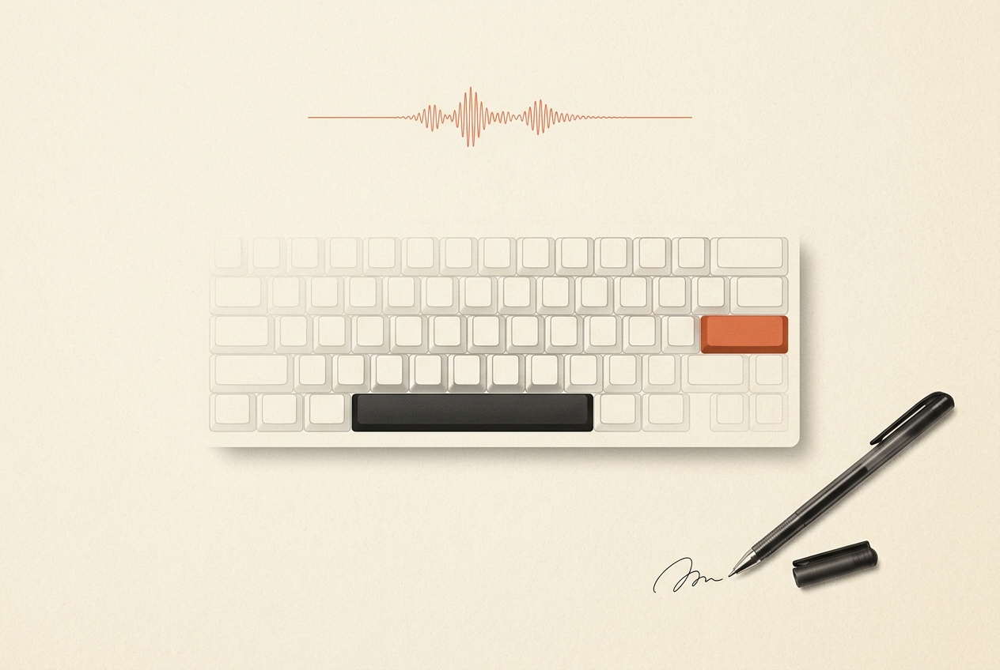

I noticed something strange recently: I think I’m slowly forgetting how to type.

Not that I’ve forgotten where the keys are. It’s just that whenever I actually have to sit down and type out a proper paragraph, my fingers feel noticeably clumsier. Typos everywhere, awkward pauses mid-sentence, deleting half a line every two lines. That effortless flow I used to have when touch-typing has somehow rusted away.

The reason is pretty simple. Ever since I went all-in on vibe coding, I barely type at my computer anymore—I just talk.

A while back I wrote [Giving My AI a Real Ear](../an-ear-for-my-ai/), mostly because typing couldn’t keep up with my thoughts, so I put a desktop mic on my desk and slipped a silicone ear over it. I didn’t think much of it at the time. A few months later, voice-to-text has completely taken over my daily input. Not just for coding—talking through specs, editing docs, replying to messages. Whenever I’m somewhere I can speak out loud, my instinct is to hold down the shortcut and start talking.

The keyboard sitting on my desk is turning into a remote control that mostly exists for Space, Enter, and hotkeys.

---

Looking back, typing is just at a natural disadvantage in vibe coding.

When you used to write code line by line, the bottleneck wasn’t typing speed—it was syntax, structure, and edge cases. The pace of a keyboard matched the pace of thinking. Now the job has flipped. You’re not carefully placing every semicolon; you’re trying to dump context, preferences, frustrations, and half-formed ideas into an agent as completely as possible.

**The moment you start typing, you subconsciously start editing things out.**

Because hitting keys takes effort, you trim your sentences and drop the background details you assume “aren’t that important.” By the time you finish, the prompt you send to AI is dry and stripped down—and it’s much more likely to miss the point.

Speaking is the opposite. There’s almost zero friction. You just let thoughts spill out, naturally carrying along the backstory and even your tone. And if voice-to-text mangles a word into some bizarre homophone, it doesn’t even matter anymore—modern models still know exactly what you meant. You don’t even bother hitting Backspace.

Once input no longer demands precision, the keyboard loses its biggest advantage.

---

This rusty feeling isn’t new at all. It immediately reminded me of the years right after I graduated from high school.

Senior year was probably the peak of my handwriting. Writing exam papers, essays, and notes every single day meant holding a pen was pure muscle memory. My handwriting wasn’t calligraphy, sure, but it was at least neat and fluid.

Then college started, and laptops and phones took over everything. Aside from signing my name or filling out the occasional delivery slip, I barely touched a pen all year. Before long, I was blanking on how to write basic characters. Even when I remembered them, they came out crooked and awkward on paper—like a grade-schooler’s homework I couldn’t bear to look at.

Now it’s the keyboard’s turn.

Handwriting never completely disappeared; it just shrank from an everyday default into an occasional ritual. Keyboards probably won’t disappear either—you still need them in quiet rooms, for precise edits, or when tapping out a quick command.

Still, **typing is probably on its way to becoming the next handwriting.**

There’s a quiet irony in the fact that even the rough idea for this post about forgetting how to type was spoken out loud first. Soon enough, typing out a long essay by hand will probably feel a lot like copying a page of text with a gel pen today—you can still do it, it just feels more awkward with every line.
