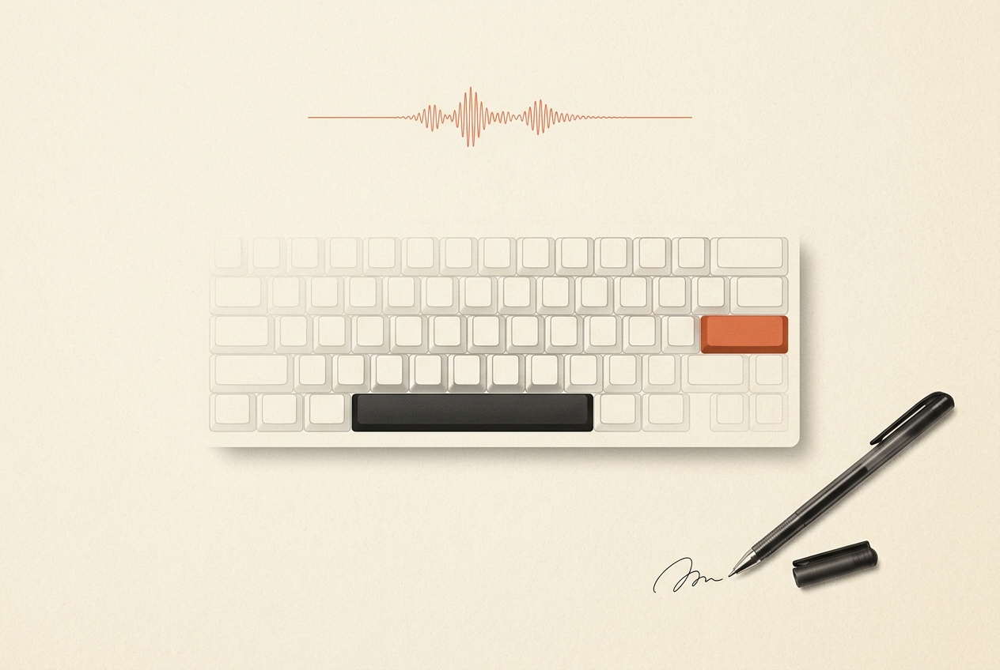

最近有个挺奇怪的发现：我好像有点不会打字了。

不是说忘了键位在哪，而是真需要自己老老实实敲一段话的时候，手指明显变笨了。拼音老按错，选词卡顿，打两行就要停下来删半行。以前盲打很顺手的那种流畅感，莫名其妙退化了。

原因其实很简单。自从高强度 Vibe Coding 以来，我对着电脑基本都在说话。

之前写过一篇 [《帮 AI 装了一只耳朵》](../an-ear-for-my-ai/)，那时候只是嫌打字跟不上脑子，给桌上立了支麦克风、套了只硅胶假耳朵。当时没想太多，结果这几个月用下来，语音转文字彻底接管了我的日常输入。不只是写代码，聊需求、改文档、发消息，只要环境允许，第一反应都是按住快捷键直接开口。

键盘放在桌子上，越来越像一个只用来按空格、回车和快捷键的遥控器。

---

回头想想，打字这件事在 Vibe Coding 里确实天然吃亏。

以前自己一行行敲代码，瓶颈不在手速，在语法、结构和边界条件，键盘的节奏刚好跟思考速度对齐。但现在活儿变了，我要做的不是把每一个分号拼对，而是把脑子里的背景、偏好、槽点和半成品想法，尽可能完整地倒给 Agent。

**一用键盘打字，人就会下意识开始“删减”。**

因为敲字累，所以你会不自觉地精简句子，省掉那些你觉得“不重要”的上下文。结果省着省着，发给 AI 的 Prompt 变得干巴巴的，它反而更容易跑偏。

说话就不一样。说话几乎没有摩擦力，想到哪说到哪，顺嘴把前因后果、甚至情绪都带进去了。哪怕语音识别把某个词转成了离谱的同音错别字，也完全无所谓——反正现在的模型都能听懂你想表达什么，连 Backspace 都懒得按。

当输入不再要求精确，键盘最大的优势也就消失了。

---

这种手生的感觉其实一点都不陌生，它让我马上想起高中毕业后的那几年。

高三大概是我人生中手写字最巅峰的时候。每天写卷子、写作文、抄笔记，笔拿在手里几乎是肌肉记忆，字不敢说多好看，至少工整顺溜。

结果一上大学，笔记本电脑和手机全面接管了文字输出。除了签个名、填个快递单，一年到头根本摸不到几次笔。没过多久就发现，自己开始提笔忘字了；就算记得怎么写，落到纸上也歪歪扭扭，丑得像小学生刚学写字，连自己都不忍直视。

现在轮到键盘了。

手写并没有彻底消失，但从“每天都在用的默认工具”，退化成了“偶尔才用一下的仪式”。键盘大概也不会消失，安静的场合、精准的微调、或者写几个命令的时候，还是得靠手指敲。

但 **打字，大概也要慢慢变成下一代“手写字”了。**

说来也挺讽刺的，连这篇讲自己不会打字的草稿，最开始的想法也是张嘴说出来的。以后真要手敲一篇长文，估计就跟现在拿中性笔手抄一页作文差不多——写是还能写，就是越写越别扭。
